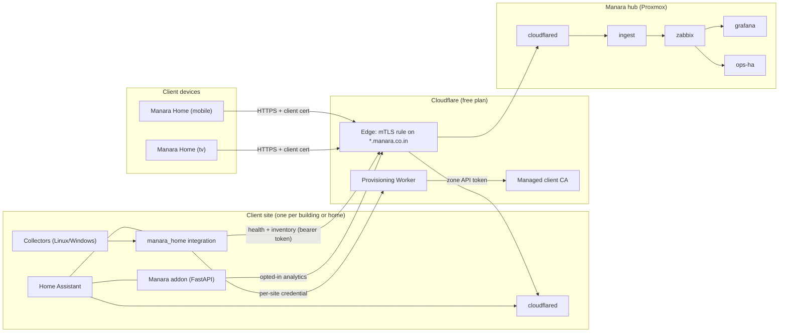

# Manara platform architecture

Manara is a smart-building ecosystem built on Home Assistant (HA). One platform serves operators (commercial buildings) and residents; residential is a lighter tier of the same product ([ADR 0001](adr/0001-one-platform-two-tiers.md)).

## Components

| Component | Where | Role | ADR |
|---|---|---|---|
| Manara Home app (`mobile`, `tv`) | Phones, tablets, wall panels, TVs | Thin patch layer on `home-assistant/android` (minimal flavour) | [0003](adr/0003-client-app-fork.md) |
| `manara_home` integration | Each site's HA (HACS) | Enrolment, device profiles, TV control, fleet health, revocation, consent, health and inventory publishing | [0004](adr/0004-site-integration.md) |
| Manara HA addon (existing, FastAPI) | Each site's HA | Flutter API and opted-in analytics forwarding | [0004](adr/0004-site-integration.md) |
| Cloudflare Tunnel | Each site and the hub | Only path in; no inbound ports anywhere | [0005](adr/0005-remote-access.md) |
| Cloudflare mTLS (managed CA) | `*.manara.co.in` | Every request needs a valid, unrevoked client certificate | [0005](adr/0005-remote-access.md), [0010](adr/0010-free-tier-mvp.md) |
| Provisioning Worker | Cloudflare Workers | Sole holder of the zone API token; issues and revokes device certificates per site | [0006](adr/0006-provisioning-worker.md) |
| Hub (Xeon D-1541, Proxmox) | Manara office | LXCs: `zabbix`, `grafana`, `ops-ha`, `ingest`; later `timescale`, `ml` | [0007](adr/0007-hub.md) |
| Ingest | Hub LXC, `ingest.manara.co.in` | HTTPS push endpoint with per-site bearer token; feeds Zabbix, later TimescaleDB | [0008](adr/0008-telemetry.md) |
| Collectors | Site hosts (Linux, Windows) | Report host health and inventory via the integration | [0002](adr/0002-data-leaving-a-site.md) |

## Diagram

## Data that leaves a site

| Class | Default | Control |
|---|---|---|
| Health (allowlisted metrics) | On, with client consent | Consent switch in `manara_home` |
| Inventory (hardware identifiers) | On, with client consent | Consent switch in `manara_home` |
| Analytics (sensor history, energy, occupancy) | Off | Per-site, per-data-class opt-in |
| Cameras, voice, location | Never | Not configurable |

The metric allowlist is fixed in code: [privacy/metric-allowlist.md](privacy/metric-allowlist.md) and [contracts/health.v1.json](../contracts/health.v1.json). See [ADR 0002](adr/0002-data-leaving-a-site.md).

## Device enrolment (outline)

1. An admin creates a device in `manara_home`, choosing a device profile. The integration shows a QR code ([contracts/enrolment-qr.v1.json](../contracts/enrolment-qr.v1.json)) holding URLs, the site ID, a profile reference and a short-lived one-time code. It never holds a certificate or key.
2. The app generates a key pair on the device and sends a CSR with the one-time code to the enrolment URL.
3. The integration checks the code and asks the provisioning Worker to sign the CSR for that site.
4. The app installs the returned certificate and connects to `ha.<site>.manara.co.in` through the tunnel with mTLS, then signs in to HA.

TODO(verify): a device has no client certificate during step 2, so the enrolment URL cannot sit behind the `*.manara.co.in` mTLS rule. It must be either the site LAN address or a hostname exempt from the rule. Spikes 1 and 2 should settle this.

## Support access

A client-owned Maintainer switch enables the site's maintainer HA user and admits Manara staff certificates for 24 hours. Every session is logged on site and on the hub, and the owner is notified ([ADR 0009](adr/0009-support-access.md)).
